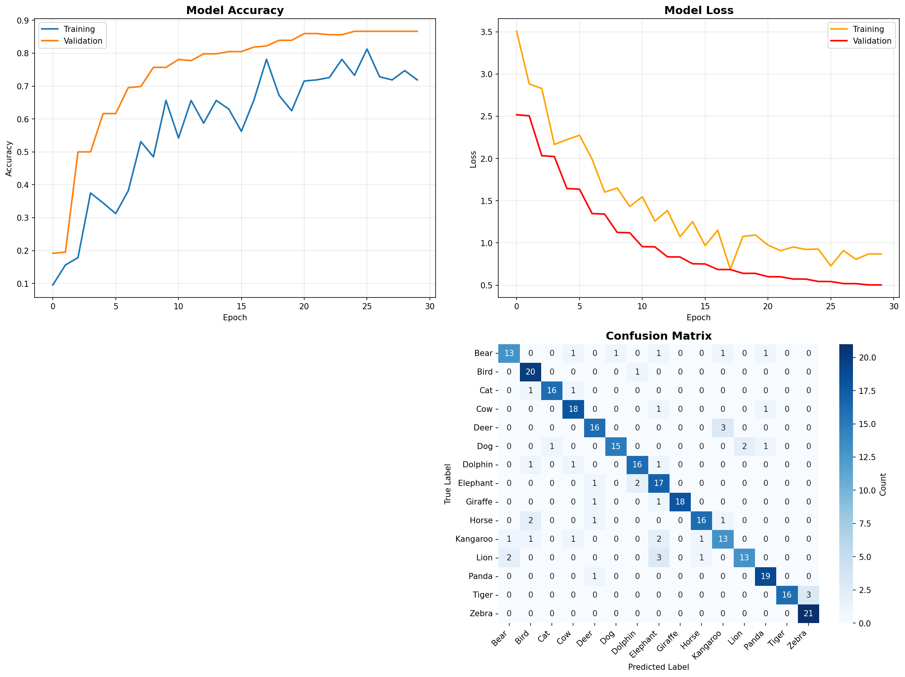
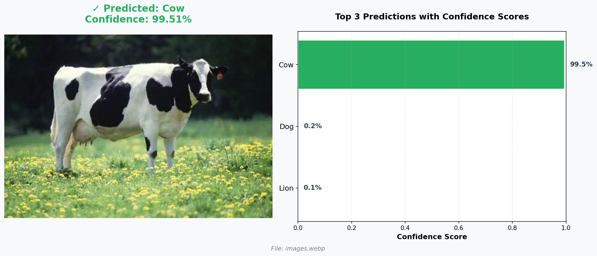

# 🐾 Image Classification of Animals

## Introduction

This project is an **Animal Image Classification** system developed using Deep Learning and Computer Vision. The main objective of the project is to identify the type of animal present in an input image.

The model is designed to classify images into **15 different animal categories**:

- Bear
- Bird
- Cat
- Cow
- Deer
- Dog
- Dolphin
- Elephant
- Giraffe
- Horse
- Kangaroo
- Lion
- Panda
- Tiger
- Zebra

The input images are resized to **224 × 224 pixels** before being given to the model. The project uses TensorFlow/Keras for model development and provides a trained model that can be used to predict animal classes from new images.

## Methods

### 1. Data Preprocessing

The images are loaded from the dataset and converted into RGB format. Each image is resized to **224 × 224 pixels** and normalized before being passed to the model.

The dataset contains 15 animal classes, and the class labels are encoded for model training.

### 2. Data Augmentation

Data augmentation is applied to increase the variety of training images and improve the model's ability to generalize.

The following transformations are used:

- Rotation up to 20°
- Width shifting up to 20%
- Height shifting up to 20%
- Horizontal flipping
- Zooming up to 20%

These transformations help the model learn from different orientations and variations of the same type of animal.

### 3. Transfer Learning

The project uses **MobileNetV2**, a pretrained convolutional neural network, with ImageNet weights.

Instead of training a deep neural network completely from scratch, MobileNetV2 is used as the feature extraction base. Additional fully connected layers are added for classifying the 15 animal categories.

The classification head contains:

- Dense layer with 256 neurons
- Batch Normalization
- Dropout
- Dense layer with 128 neurons
- Batch Normalization
- Dropout
- Softmax output layer with 15 classes

The model contains approximately **2.62 million parameters**.

### 4. Model Training

The model is trained using the **Adam optimizer** and categorical cross-entropy loss.

The following callbacks are used during training:

- **EarlyStopping** – stops training when validation performance stops improving.
- **ModelCheckpoint** – saves the best performing model.
- **ReduceLROnPlateau** – reduces the learning rate when validation loss stops improving.

The model also tracks:

- Training accuracy
- Validation accuracy
- Top-3 accuracy
- Training loss
- Validation loss


### 5. Model Evaluation

After training, the model is evaluated using a test dataset.

The evaluation includes:

- Accuracy
- Top-3 accuracy
- Classification report
- Confusion matrix
- Per-class accuracy

The project also generates training and validation accuracy/loss graphs to analyze the model's learning behavior.

### 6. Image Prediction

For a new image, the system:

1. Loads the image.
2. Converts it to RGB format.
3. Resizes it to 224 × 224 pixels.
4. Normalizes the pixel values.
5. Passes the image through the trained model.
6. Selects the class with the highest prediction probability.
7. Displays the predicted animal and confidence score.

The system can also return the **top 3 predicted animal classes** with their confidence scores.

## Output

The project produces several outputs during training and prediction.

### Training Results

The training results include:

- Training accuracy
- Validation accuracy
- Training loss
- Validation loss
- Learning-rate behavior
- Confusion matrix



### Prediction Output

For an input animal image, the model predicts the animal category along with its confidence score.

Example:

```text
Input Image: animal image

Predicted Animal: Dolphin
Confidence: XX.XX%

Top 3 Predictions:
1. Dolphin - XX.XX%
2. _______ - XX.XX%
3. _______ - XX.XX%
```



The repository also contains example prediction and workflow images generated by the project.

## Conclusion

This project demonstrates how **Deep Learning and Transfer Learning** can be used to classify animal images automatically.

By using **MobileNetV2**, data augmentation, dropout, batch normalization, and training callbacks, the system can learn useful visual features and classify images into 15 different animal categories.

The project also demonstrates the complete machine-learning workflow:

**Image → Preprocessing → Data Augmentation → Feature Extraction → Classification → Prediction**

The trained model can be further improved by increasing the size and diversity of the dataset, fine-tuning more layers of MobileNetV2, and deploying the model as a web or mobile application.

## Technologies Used

- Python
- TensorFlow
- Keras
- MobileNetV2
- NumPy
- Matplotlib
- Seaborn
- Scikit-learn
- Pillow
